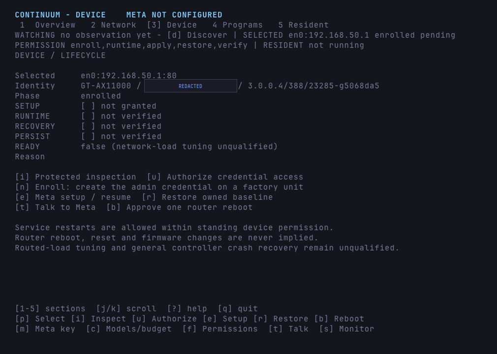
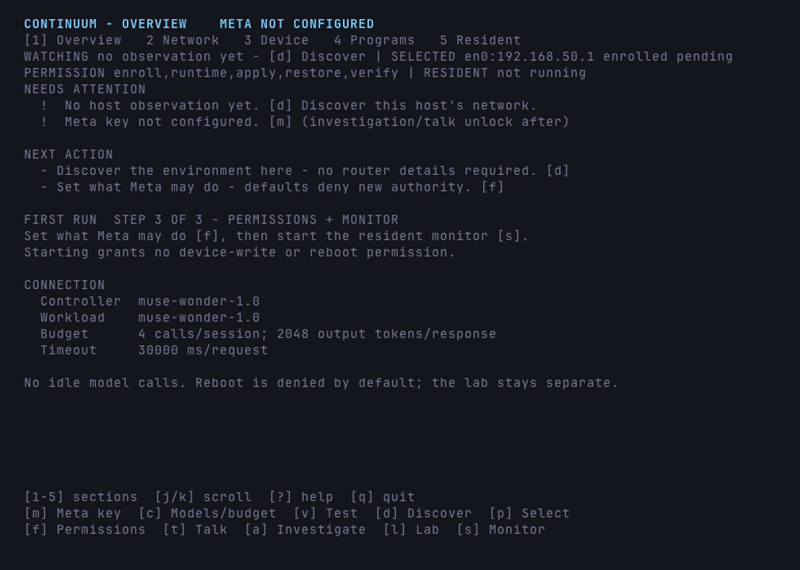

# Continuum

[](https://github.com/AdityaVG13/Continuum/releases)
[](LICENSE)

**A network control plane your agent can use and cannot run away with.**

One binary on your Mac. It finds the router you physically own, enrolls a
factory-fresh unit without asking for a password that does not exist, commissions
it through the vendor's own interface, shapes its WAN queue with CAKE it can
undo, and proves each step with a receipt. When a change is unsafe or the unit
cannot support it, Continuum refuses with a typed reason instead of leaving a
half-state behind.

Healthy operation spends no model calls. Every write needs the permission you
granted. Every uncertain effect is reconciled, never replayed.

Built for the Meta Global AI Developer Hackathon (indie track, Push-the-Frontier).
The claim under test: a model that sees the task *and* the path makes better
bounded choices than a competent static rule, and the product can prove what it
did without asking the owner to trust the model.

Goose is the primary implementation language; C++ supplies the native transport
boundaries and the fallback path. Reasoning comes from Meta's `muse-wonder-1.0`
through the Responses API: every call is bounded by model, token and call caps,
and healthy operation spends none.



*The Device screen on a real unit: identity read from the router, lifecycle
gates unclosed until each is actually verified, every disruptive action behind
its own key. The MAC is masked.*

## The demo, in five keys

| key | what happens |
| --- | --- |
| `d` | reads this host's interfaces, routes and neighbor candidates. No key, no scan. |
| `p` | binds the router you say you own. Selection grants no write permission. |
| `n` | enrolls a factory-pending unit: mints the admin credential, stages it in the OS keychain, submits the vendor's first-run form, proves a protected read. |
| `f` | sets the operations and constraints the model may ever use. Meta can read this policy, never widen it. |
| `e` | hands the commissioned device to Meta for bounded, reversible setup, with every effect receipted and a way back. |

The enrollment line is the one people do not believe. A factory-reset GT-AX has
**no admin password to type**, so Continuum generates one, stores it before the
first write, and then proves the device accepts it: the factory default
`admin/admin` is dead afterwards, a retry inspects instead of replaying the
ceremony, and no credential material reaches the transcript or the durable state
file. Vendor wizards do not do this; that is the point.

## Three guarantees that make it safe to point at hardware

1. **The model never holds the shell.** Meta chooses from a typed tool surface
   (`manage_device`, `apply_qos`, ...). It never receives router credentials,
   never composes a shell command, and never widens the policy you set.
2. **Every effect is a transaction.** Before-image captured, change applied,
   independent readback, rollback on drift. A model's claim of success is not
   evidence; the readback is.
3. **Refusal is a first-class result.** No `tc` on the unit, a vendor-managed
   root qdisc, an out-of-bounds profile, a rate the device did not honor: each
   comes back as a typed refusal, not a half-applied network.

## Prove it yourself

```console
$ make check-all
CHECK_ALL_GREEN
```

Nine contract suites, a 6,060-case tool-JSON fuzz lane, the full device
lifecycle against a loopback ASUS double, live measurement, and the signing
policy. No provider key, no hardware, no remote worker: about two minutes of
wall time and under half a minute of CPU.

The lane that matters for the demo is the enrollment gate. It drives a
factory-pending unit end to end and fails on any of: a bare `enroll` that is not
refused, a surviving factory default, a surviving pre-existing password, a
replayed first-run form on retry, a credential in output or durable state. Flip
the execute gate in `src/device.goose` and that test goes red: it fails for the
reason it exists, not because it was written to pass.

## What works today

- **Enrollment that creates its own credential.** No password to type, staged
  before the first write, proven by a protected read.
- **Commissioning you can undo.** Private backup, bounded process inventory,
  allowlisted sharing changes, device-local rollback, exact-prior-flags restore.
  The GT-AX11000 has carried these settings across a real reboot.
- **Traffic control with a preflight.** Read-only `qos-status` decides whether
  the unit can host a qdisc at all; `--device-qos` applies a bounded CAKE profile
  and independently reads back the requested rate; `--device-qos-restore` puts
  the original back.
- **Evidence or refusal.** `--measure` samples idle and loaded RTT and goodput,
  refuses to certify a run it did not sample, and only counts an upload the far
  end actually accepted. `--device-qualify` opens `READY` only from a receipt
  recorded after the last baseline change, and a qdisc change closes it again.
- **A governor, not a wrapper.** Typed tool surface, owner policy in front of
  every effect, separate owner approval for a reboot, and no credential or shell
  ever handed to the model.
- **A resident that stays quiet.** Healthy monitoring spends zero model calls;
  setup, dialogue and incidents share one selected-device dispatcher.

<details>
<summary>Every implemented surface, in detail</summary>

- Interactive Goose/C++ TUI for masked Meta key entry, optional macOS Keychain
  storage, model/budget settings, host discovery and bounded Meta investigation
  (`make tui`). No management IP is required to start; candidate identity stays
  unverified until evidence supports it.
- Live resident host monitor (`--serve`), independent of the setup UI: bounded
  IPv4 route/interface observations, blocking waits, private replaceable status,
  duplicate-owner exclusion and opt-in Meta incident handling. Setup, owner
  dialogue and incidents share one selected-device capability dispatcher;
  standing permission allows only the operations the owner has granted; reboots
  need separate explicit or standing owner approval.
  Service call reservations and cooldown survive ordinary process restarts.
- Deterministic sim loop and daemon (no network, no model calls).
- Typed tool-call binding, workload-result validation and Meta
  request/continuation builders with failure-first suites.
- Goose-to-C++ virtual-router loop against a lab double
  (`make web-e2e-run` -> `WEB_E2E_ALL_GREEN`).
- Meta HTTPS transport (`native/meta_web.cpp`): one bounded Responses
  call per submit via the system TLS stack; fail-closed without a key
  (`make meta-live`).
- One supervised runtime: controller-selected action against the chosen
  simulator or loopback HTTP backend, Meta audit workload with separate
  tools/context, independent seeded-evidence validation, and exit restoration
  (`make loop`, or `make loop-router` against the C++ double).
- Completed-work continuity: the CLI durably commits an accepted audit only
  after session cleanup; `--resume <run-id>` independently revalidates that
  artifact against exact current inputs without Meta or router actions. This
  is completed-output recovery, not continuation of unfinished inference.
- Owner-selected device lifecycle in the main CLI/TUI: persist one observed
  candidate and verify its protected device/firmware identity. Meta directs setup
  and supported reversible commissioning through `manage_device`; it chooses
  which optional services to change rather than inheriting a fixed cleanup.
  Device reboots require separate owner authority at the guarded boundary.
  Owner dialogue (`--talk`, TUI **t**), bounded device knowledge and workflow
  skills are shared with resident incidents; no fixed reboot schedule or
  redundancy topology is built in.
- ASUS-only commissioning after enrollment: private backup, bounded full-process
  inventory, allowlisted sharing-service cleanup and device-local rollback.
  The dedicated GT-AX11000 retained its lean settings across a real reboot;
  `verify` requires a changed boot and protected settings/runtime readback.
  Commissioning remains incomplete until the remaining network gates pass.
- Owner-configurable execution, allowed operations, protected clients/services,
  program limits and retention, shared by setup, conversation and the resident.
  Meta can install and run bounded authored local logic, not just compose fixed
  operations. Its output is an intent submitted through the same permission
  boundary; isolated code never receives router credentials or direct control.

</details>

## Where the line is

Two things are deliberately not dressed up:

- **The CAKE/qdisc path has not run on hardware yet.** It is proven end to end
  against the ASUS double, including an absent `tc`, a vendor-managed root, an
  out-of-bounds profile, rate clamping and a verified restore. The physical run
  is the next item on the bench, and `docs/STATUS.md` will record it when it
  lands.
- **Optimization observations are still synthetic** in the supervised control
  loop. Live telemetry is what turns "better than a static rule" into a measured
  claim, so no latency or goodput number is quoted anywhere in this repository
  until that run exists.

The ASUS onboarding ceremony has already completed on a physical GT-AX11000 in
both firmware branches with outcome `Verified`; what remains is the same
ceremony driven through the shipped CLI path rather than the lab script.

Everything else (the full ledger, including what is still closed) is one row
per capability in [`docs/STATUS.md`](docs/STATUS.md), each with the evidence
that backs it.

## Quickstart

### Install a release

macOS arm64 archives are published under
[Releases](https://github.com/AdityaVG13/Continuum/releases). The binary opens
`docs/prompts`, `schemas` and `fixtures/corpus` by relative path, so unpack it
and run `bin/continuum` from the unpacked root, or install it under
`~/.local/share/continuum` with a launcher on `PATH` as the archive's
`INSTALL.txt` describes. Confirm the build with `continuum --version`.

### Interactive setup

Run `make install` once; it puts `continuum` on `PATH` (`~/.local/bin`).
Then **`continuum` with no arguments is the whole entry point.** It reads this
host at startup (local interfaces/routes only, no scan and no provider call) and
opens on a **setup wizard**: one step per screen, one `[Enter]` per step, and
each screen states exactly what that step will do.

```text
STEP 1 OF 8   BIND THE ROUTER
STEP 2 OF 8   ENROLL THE ROUTER
STEP 3 OF 8   META KEY
STEP 4 OF 8   SET THE ROUTER UP
STEP 5 OF 8   REBOOT
STEP 6 OF 8   VERIFY PERSISTENCE
STEP 7 OF 8   TUNE
STEP 8 OF 8   MEASURE
```

Every step keeps its own confirm frame, and the footer always shows where you
are in that path. `[Esc]` quits; `[a]` opens the five panels (Overview, Network,
Device, Programs, Resident) for the receipts and evidence, and `[Esc]` there
returns to the wizard.

Several default-route candidates are never guessed: binding one of several
stays an explicit `[p]` choice. A unit that is already configured is never
factory-enrolled: the ceremony refuses without writing, and the failure screen
offers `[p]` to take the unit over with the admin password it already uses --
read hidden, stored in the OS vault, and proven by a protected read.

From the checkout root, `make tui GOOSE=/absolute/path/to/goose` builds and
opens the same TUI; `.build/continuum` opens it without a rebuild.

The TUI is organized into five sections: `[1]` Overview, `[2]` Network,
`[3]` Device, `[4]` Programs, `[5]` Resident, plus `?` help. A pinned strip on
every screen answers: what is watched (with observation age, e.g. `just now`),
which device is selected, what Meta may do under the current permissions, and
whether the resident is running. Job results render on their own Result screen.
`j/k`/arrow keys scroll, `J/K` and `PgUp/PgDn` page; `q` cancels a running job
and quits. While busy, only `q` works and the footer says so.



*First run with no key: the screen states what to do next and what it will not
do, and the permission strip shows the device grant as it stands.*

First run advances in four steps: discover this host's network, select the
device you own, enroll a factory-pending unit (the program creates the admin
credential), then set permissions and start the resident monitor. No Meta key is
needed for any of them.

- **m**: enter `MODEL_API_KEY` privately, with masked input. Keep it for the
  session or explicitly save it in macOS Keychain; it never enters the model
  context, settings file or transcript.
- **c**: set controller/workload models, output-token cap, call limit and timeout.
  Only non-secret settings are persisted under `$XDG_CONFIG_HOME/continuum`
  (or `~/.config/continuum`).
- **v**: confirm one bounded Meta connection test. A staged key is not shown
  as verified until that test succeeds.
- **d** (Network): read this host's interfaces, connection kinds, route gateways and
  neighbor-cache candidates, with the observation age shown in the strip. No key,
  address lookup or active scan is needed.
- **a**: confirm a bounded Meta investigation using those observations and
  read-only discovery tools. Candidate page titles are untrusted clues, not
  authenticated device identity or permission to modify a router.
- **p** (Network/Device): choose a device from the observed candidates. Selection alone grants
  no write permission. New enrollment gets separate credential references; the
  existing-credential option uses the address-scoped references, not arbitrary
  credentials from a previous standalone run.
- **o** (Device screen) / **i** (Device): show saved lifecycle gates ([OK]/[ ] checklist) / perform a protected inspection.
  **u** separately authorizes access to an existing protected credential; ordinary
  inspection and resident monitoring refuse unavailable access without an OS dialog.
- **n** (Device): enroll a factory-pending unit. Generates the admin credential
  and PSK, stages them in the OS vault before the first write, submits the
  vendor's first-run form and verifies a protected read under the new
  credential. Refused without explicit execute; a retry inspects instead of
  replaying the ceremony.
- **e** (Device): grant standing permission for Meta-directed setup and supported
  reversible operations on the selected device, within your owner policy. Use
  **f** to choose allowed operations and constraints; Meta cannot change that
  policy through conversation. The default does **not** approve a device
  reboot. Uncertain effects are not blindly repeated. **r** confirms restoration
  of the owned baseline, not a factory reset. **b** separately confirms one
  baseline-related device reboot; it is never scheduled or implied by setup.
- **f**: set execution host, local-program opt-in, device operations, protected
  users/devices and services, program slots, retention and execution timeout.
  The launching computer is the execution default, not a remote shell endpoint.
- **g** / **4** (Programs): inspect installed programs and their execution/reconciliation state
  locally, without a key or model call. `[Enter]` reads a program by id,
  `[x]` disables, `[E]` enables, `[R]` reconciles, through the same guarded
  registry tools the CLI (`--program-*`) and the resident use.
- **t**: talk to Meta about this host or selected device, requirements and priorities.
  Up to one bounded exchange and a concise model-maintained device note survive
  between requests. Do not enter passwords here; credential access remains private.
  From the CLI: `.build/continuum --talk 'Keep FTP enabled. What changed?'`.
- **s** (Resident): set monitoring interval, incident cooldown, service call cap and
  one-time permission for automatic Meta incident handling, then confirm
  background startup. This does not itself grant device-write permission;
  incidents use the same standing device grant and guards as foreground setup. The monitor continues after this UI closes. Existing
  monitors are not reconfigured; reboot autostart is not installed.
  Resident shows live phase/pid/samples/calls read back from
  `service/status.json`, not a stub.
- **l**: run the existing supervised controller/workload lab path, isolated from
  physical targets. **q** or **Ctrl-C** cancels the current UI job and exits,
  without stopping a separately started background monitor.

The model instructions are in `prompts/device.md`; on-demand commissioning,
optimization and reusable-program skills are in `prompts/workflows/`. Basic
profiling and transaction scripts live behind the native capabilities, not a
second orchestration engine. Programs can compose those operations or contain
bounded model-authored POSIX shell logic in the local OS sandbox. This is not
unrestricted shell/HTTP execution or installation on an arbitrary remote host.

### Owner control and bounded maintenance

Choose the private state location with an absolute `CONTINUUM_HOME`; otherwise
the usual XDG configuration location is used. Execution currently supports this
computer (`local`) or `disabled`, not remote deployment. Existing supported
device operations still run against the explicitly selected, identity-bound
device. Secure credential storage remains managed by the OS adapter.

`--owner-policy` reads the complete policy; `--owner-policy-set '<JSON>'` replaces
it after validation. Setup **f** is the interactive editor. Allowed operations
and protected services narrow the separate device grant, and are rechecked
before effects. A protected-client requirement refuses affected operations
because the current adapter cannot prove that named clients stay connected;
it is not a connectivity guarantee. Meta may read the policy, never widen it.

`--program-install '<JSON>'`, `--program-list`, `--program-read <id>`,
`--program-run <id>`, `--program-disable <id>`, `--program-enable <id>`,
`--program-reconcile <id>` and `--program-prune` use the same local registry as
Meta and the resident. The exact program format is in
`prompts/workflows/programs.md`. Local code is opt-in and receives a bounded
JSON observation, not inherited keys or unrestricted filesystem/network access.
macOS uses Seatbelt; Linux requires working bubblewrap namespaces and otherwise
refuses execution. Returned actions still need ordinary guardian approval.

Source and the latest result share one bounded private registry. Owner-selected
slots and retention prevent script-file/per-run-log accumulation. Expiry compacts
only inactive, resolved records; active schedules and uncertain/failed work are
retained for reconciliation. Recurring native inventories and event receipts
replace bounded latest observations, while recovery baselines stay immutable.
No existing backup files are automatically deleted. Healthy recurring work
does not call Meta; incidents and owner conversations retain their paid-call caps.

Meta discovers technical facts rather than asking the owner to supply them.
Multiple plausible devices remain an owner-selection question, not permission
for the model to silently change the live gateway. There are no idle model
calls. The TUI is Goose with native C++ terminal/OS boundaries; Python is used
only by its PTY acceptance test. Secure persistence is currently macOS-only;
other platforms offer session-only keys. IPv6 management is not yet collected.

### Platform credential identity

Credential references and the `ct_vault_*` C ABI are platform-neutral. OS-owned
secure storage belongs in the host adapter, not Goose policy or model context.
macOS Keychain is implemented; Linux Secret Service and Windows Credential
Manager adapters are not. An unavailable secure backend must refuse persistent
storage, never substitute plaintext files or the environment-backed test vault.
Apple signing is not a dependency of non-macOS builds. This separation does
not certify a native Windows port or implement its remaining OS boundaries.

On macOS, select a real signing certificate by name or fingerprint using
`MACOS_SIGN_IDENTITY`. For persistent local configuration, put that public
selection in `.build/signing.mk` as `MACOS_SIGN_IDENTITY ?= <fingerprint>`;
`.build/` is gitignored. No personal certificate, private key or password is
committed. Run `make sign GOOSE=/absolute/path/to/goose` to build, sign and
verify both production executables without running either. Configured rebuilds
also sign automatically, using distinct stable identifiers
`org.continuum.controller` and `org.continuum.leap`. Local signatures omit the
network timestamp; this is not a notarization/distribution pipeline.

Unsigned development builds remain possible, but their linker/ad-hoc identity
changes with their contents and cannot promise retained Keychain authorization.
A first certificate-signed build may still need explicit owner authorization
for an existing item. Keep the certificate and application identifier consistent
across rebuilds; switching signer/identifier is a new authorization boundary.
Signing does not grant access to existing credentials, change their ACLs, or
weaken the background reader's fail-closed, no-dialog policy. `make signing-check`
checks the build policy without using a certificate or touching credentials;
non-macOS recipe checks are not native OS execution proof.

### Headless checks and lab commands

Fetch the pinned Goose v2026.3 compiler for your platform
(assets and hashes in `TOOLCHAIN.lock.json`), then from the repo root:

```sh
export GOOSE=/absolute/path/to/goose
make check-all                              # full local gate
make check status sim daemon test native-check   # the lanes, individually
```

`make check-all` is the full local gate: typecheck, the contract suites, the
device lifecycle against the loopback double, live measurement, and the signing
policy, ending in `CHECK_ALL_GREEN`. It needs no provider key, no hardware and no
remote worker; on an M-series laptop it takes about two minutes of wall time and
under half a minute of CPU. The wall time is device time that must actually
elapse (a trial lease that expires unaided, a post-apply settle window) and live
sampling loops, not build or analysis cost.

These targets typecheck, build the status ledger, exercise the deterministic
sim/daemon and nine contract suites, and syntax-check the C++ sources.
The request golden now describes the actual six-tool controller allowlist;
the former nine-tool mismatch is preserved in the historical status ledger.
These lanes make no provider or physical-router requests.
`make continuity-check` additionally exercises durable commit, cross-process
recovery and stale/invalid-output refusal through an authored model transport.
`make device-check` exercises selected-device setup through the main CLI,
commissioning/reboot persistence, restart handoff into the resident, actual
read-tool result continuation and physical-write/changed-identity refusal. It
uses a loopback ASUS double and authored host/Meta boundaries, not hardware or
live model inference. `make setup-check service-check` exercises the PTY setup
and real host monitor as well as the bounded incident conversation.

For headless device operation, `--device-select <candidate-id> <ssid-stem>`
requires an exact candidate from current `--discover` output. `--device-status`
reads saved gates; `--device-step inspect` refreshes protected evidence;
`--device-step authorize` is the separate owner-interaction action.
Re-selecting the same candidate is the recovery action after a factory reset:
it discards the stale binding (identity, gates and standing permission) and
returns the record to `selected`, so enrollment can run again. A different
candidate still cannot clobber a live binding.
`--device-step setup --execute` approves the initial transaction, including
reboot. `--device-step restore --execute` restores the owned baseline.
The last gate is earned, not asserted: `--measure host:port/path /loadpath`
records a claimable loaded run, and `--device-qualify <evidence> --execute`
opens `READY` only when that receipt postdates the last lifecycle change. Any
qdisc apply or restore closes it again, so the next change gets measured too.
These are real device operations, not lab shortcuts; do not run them on an
unapproved target. No device operation silently substitutes the default gateway.

The virtual-router lanes run against the C++ double on localhost and
are self-contained:

```sh
make transport-check web-e2e-run asus-check leap-e2e
```

Two manual probes need the outside world and stay out of `make test`:

```sh
# One bounded Meta round trip, or a fail-closed check with no key
MODEL_API_KEY='<key>' META_CONTROLLER_MODEL='muse-wonder-1.0' make meta-live

# Leap ceremony against real hardware (dry run unless LEAP_EXECUTE=1)
ROUTER_HOST=<router> SSID_STEM=<stem> make leap
```

The Meta probe reads the key from the environment at submit time, never
logs it, and refuses to run without one.

`MODEL_API_KEY` is the official Meta environment-variable name, not
`META_API_KEY` ([Meta overview](https://dev.meta.ai/docs/overview)). Set it
locally without putting the value in this repository or chat. With it set:

```sh
make loop-router GOOSE="$GOOSE"
```

This spends bounded Meta calls for the controller and audit workload and
prints one JSON run record. `META_CONTROLLER_MODEL` and `META_TASK_MODEL`
select the roles independently. The controller may abstain; a scripted
profile is never substituted. The record distinguishes synthetic observations,
recorded/live model responses, verified restoration and durable task-commit
status. The CLI publishes an immutable private artifact under
`$XDG_CONFIG_HOME/continuum/runs/<run-id>.json` (default `~/.config/continuum`).
Supply an explicit identity with `.build/continuum --loop <run-id>`; recover
completed work with `.build/continuum --resume <run-id>`, even with no key.
Recovery must use the same checkout inputs and task-model setting; it neither
replays an intervention nor retries an uncertain external effect.
`make web-e2e-run` exercises the shared runtime with explicitly authored
responses and no provider calls. `docs/STATUS.md` separates this working slice
from the larger unproven product thesis; the session continuity ledger is kept
locally (`docs/progress/`) and is not published.

## Repository layout

| Location | Contents |
| --- | --- |
| `docs/SPECIFICATION.md` | Product thesis, architecture, lifecycle, ownership modes, boundaries. |
| `docs/MODEL_INTEGRATION.md` | Meta roles, Responses protocol usage, tool loop, budgets, failure policy. |
| `docs/STATUS.md` | What is implemented, what is not, and the evidence for each. |
| `docs/DEMO_RUNBOOK.md` | Three-minute stage sequence and required live proof. |
| `docs/IMPLEMENTATION_MAP.md`, `docs/LAB.md` | Source-to-capability map; what the lab proves and does not. |
| `docs/prompts/`, `schemas/`, `config/`, `fixtures/` | Controller/workload/device/discovery prompts, wire contracts, example configs, synthetic fixtures. |
| `docs/images/` | Terminal captures used by this README, rendered with VHS at a fixed grid. |
| `src/` | Goose implementation: sim, guardian, actuator, tool binding, Meta provider, onboarding planner + leap ceremony. |
| `src/main.build`, `tests/*.build` | Toolchain sidecars linking the native sources into each binary. |
| `native/` | C ABI (`continuum_native.h`), router HTTP backend, Meta HTTPS adapter, ASUS onboarding adapter, macOS keychain/Wi-Fi host backend, C++ fallback stubs. |
| `tests/` | Contract suites, the C++ virtual-router double (`router_double.cpp`), native harnesses, and the manual probes. |
| `verification/` | Dated gate log and artifact summary. |

## Claim discipline

- Synthetic fixtures are designed inputs. No live Meta response or
  measured Internet result is bundled anywhere.
- A model tool call is not proof of success: admission, readback and
  verification receipts are separate records, and the demo shows all of
  them.
- Comparisons name their baselines, sample counts and configurations,
  or they are not made.
- Anything that has not passed its gate is described in future tense.

## License

MIT - see `LICENSE`.
